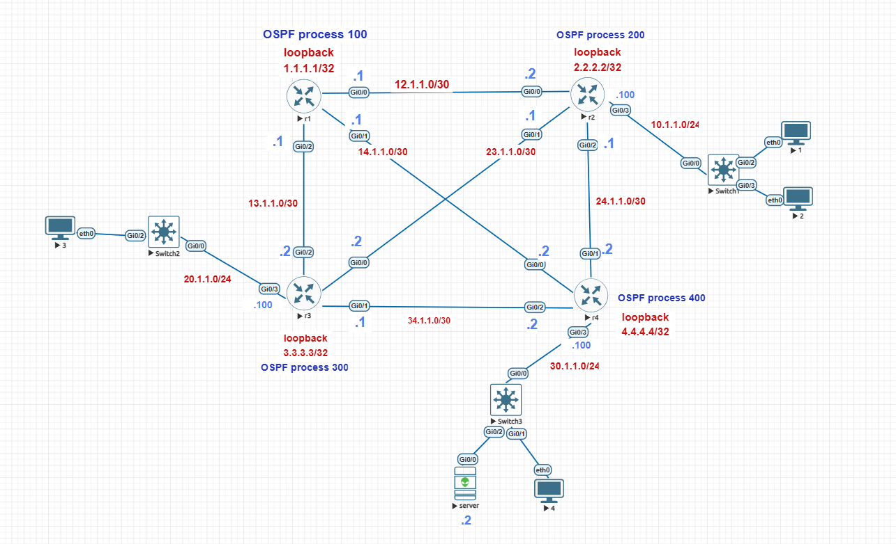

# Enterprise OSPF + Centralized DHCP

## Project Overview

This project demonstrates an enterprise-style routed network built in EVE-NG using Cisco IOS routers. It uses OSPF as the dynamic routing protocol and a centralized DHCP server to provide IP addressing to clients across multiple LANs.

The project demonstrates routing configuration, OSPF neighbor formation, DHCP relay, centralized address allocation, and end-to-end connectivity testing.

## Objectives

- Build a four-router enterprise topology.
- Configure OSPF Area 0 across all four routers.
- Advertise router loopbacks and LAN networks through OSPF.
- Configure a centralized DHCP server.
- Configure DHCP relay on R2, R3, and R4.
- Verify routing tables, DHCP leases, and inter-LAN connectivity.

## Technologies Used

- EVE-NG
- Cisco IOS routers
- OSPF
- DHCP
- DHCP relay (`ip helper-address`)
- Virtual PCs (VPCS)

## Network Topology

The network contains four interconnected routers, three client LANs, and one centralized DHCP server.



- **R1:** Core routing connectivity.
- **R2:** LAN10 gateway.
- **R3:** LAN20 gateway.
- **R4:** LAN30 gateway.
- **SERVER:** Central DHCP server connected to LAN30.

See `topology/enterprise-topology.png` for the topology diagram.

## IP Addressing Plan

### Router Loopbacks

| Device | Loopback Address |
|---|---|
| R1 | 1.1.1.1/32 |
| R2 | 2.2.2.2/32 |
| R3 | 3.3.3.3/32 |
| R4 | 4.4.4.4/32 |

### Point-to-Point Links

| Link | Network | Device Addresses |
|---|---|---|
| R1–R2 | 12.1.1.0/30 | R1: 12.1.1.1, R2: 12.1.1.2 |
| R1–R3 | 13.1.1.0/30 | R1: 13.1.1.1, R3: 13.1.1.2 |
| R1–R4 | 14.1.1.0/30 | R1: 14.1.1.1, R4: 14.1.1.2 |
| R2–R3 | 23.1.1.0/30 | R2: 23.1.1.1, R3: 23.1.1.2 |
| R2–R4 | 24.1.1.0/30 | R2: 24.1.1.1, R4: 24.1.1.2 |
| R3–R4 | 34.1.1.0/30 | R3: 34.1.1.1, R4: 34.1.1.2 |

### LAN Networks

| LAN | Gateway | Network |
|---|---|---|
| LAN10 | 10.1.1.100 | 10.1.1.0/24 |
| LAN20 | 20.1.1.100 | 20.1.1.0/24 |
| LAN30 | 30.1.1.100 | 30.1.1.0/24 |

### Central DHCP Server

| Setting | Value |
|---|---|
| Device name | SERVER |
| Interface | GigabitEthernet0/0 |
| IP address | 30.1.1.2/24 |
| Next hop for remote networks | 30.1.1.100 |

## OSPF Configuration

OSPF is configured in Area 0 across all four routers.

| Router | OSPF Process ID | Router ID |
|---|---:|---|
| R1 | 100 | 1.1.1.1 |
| R2 | 200 | 2.2.2.2 |
| R3 | 300 | 3.3.3.3 |
| R4 | 400 | 4.4.4.4 |

OSPF process IDs are locally significant and do not need to match between routers. Each router advertises its loopback, router-to-router links, and connected LAN where applicable.

## Centralized DHCP Design

The SERVER router provides DHCP services for all three LANs.

| DHCP Pool | Network | Default Gateway |
|---|---|---|
| LAN10 | 10.1.1.0/24 | 10.1.1.100 |
| LAN20 | 20.1.1.0/24 | 20.1.1.100 |
| LAN30 | 30.1.1.0/24 | 30.1.1.100 |

Addresses from `.1` through `.9` are excluded from each DHCP pool for infrastructure and reserved use.

### DHCP Relay Configuration

R2, R3, and R4 relay client DHCP requests to the centralized server at `30.1.1.2` using the following command on each router's LAN interface:

```cisco
interface GigabitEthernet0/3
 ip helper-address 30.1.1.2
```

The server uses a default route via R4 (`30.1.1.100`) to reach remote LANs. DHCP relay agents forward DHCP messages between the server and clients on their respective LANs.

## Verification and Results

The following tests were performed in EVE-NG:

- OSPF neighbor relationships verified on R1–R4.
- OSPF routing tables checked on R1–R4.
- DHCP leases verified on the centralized server.
- Client IP assignment verified on PC1–PC4.
- Cross-LAN connectivity tested using ICMP ping.

### DHCP Lease Results

| Client | Assigned IP Address |
|---|---|
| PC1 | 10.1.1.10 |
| PC2 | 10.1.1.11 |
| PC3 | 20.1.1.10 |
| PC4 | 30.1.1.10 |

### Connectivity Tests

- PC1 (`10.1.1.10`) → PC3 (`20.1.1.10`): Successful.
- PC1 (`10.1.1.10`) → PC4 (`30.1.1.10`): Successful.

Screenshots of OSPF neighbors, routing tables, DHCP leases, and connectivity tests are stored in the `verification/` directory.

## Repository Structure

```text
enterprise-ospf-centralized-dhcp/
├── README.md
├── topology/
│   └── enterprise-topology.png
├── configurations/
│   ├── R1.txt
│   ├── R2.txt
│   ├── R3.txt
│   ├── R4.txt
│   └── DHCP-SERVER.txt
└── verification/
    ├── ospf-neighbors-r1.png
    ├── ospf-neighbors-r2.png
    ├── ospf-neighbors-r3.png
    ├── ospf-neighbors-r4.png
    ├── routing-table-r1.png
    ├── routing-table-r2.png
    ├── routing-table-r3.png
    ├── routing-table-r4.png
    ├── pc1-dhcp-lease.png
    ├── pc2-dhcp-lease.png
    ├── pc3-dhcp-lease.png
    ├── pc4-dhcp-lease.png
    ├── dhcp-bindings-server.png
    ├── ping-pc1-to-pc3.png
    └── ping-pc1-to-pc4.png
```

## Skills Demonstrated

- Cisco IOS router configuration
- IPv4 addressing and subnetting
- OSPF routing and neighbor verification
- Centralized DHCP pool configuration
- DHCP relay configuration
- Routing table analysis
- End-to-end network troubleshooting
- Network lab documentation

## Conclusion

This project demonstrates how dynamic routing and centralized DHCP services can be combined in a multi-router enterprise-style network. The lab validates OSPF route learning, automatic client addressing, and communication between separate LANs.

The topology and configuration files can be used to review and reproduce the lab in EVE-NG.
